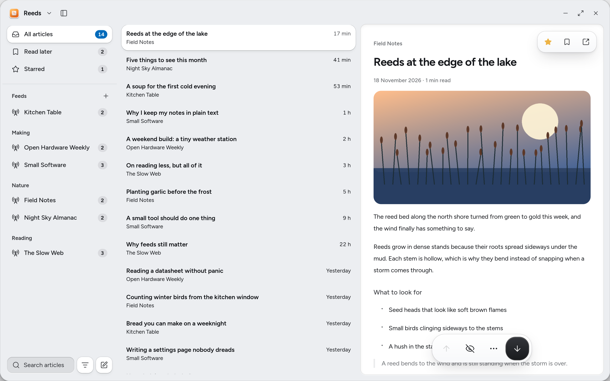
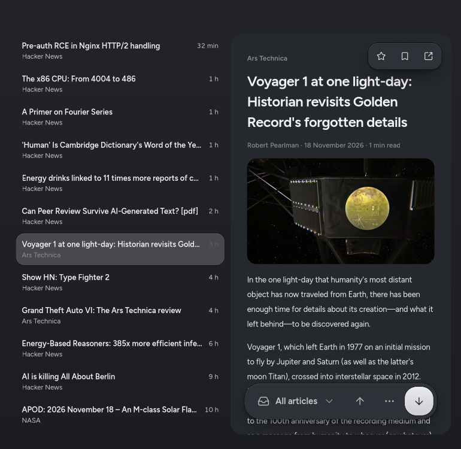
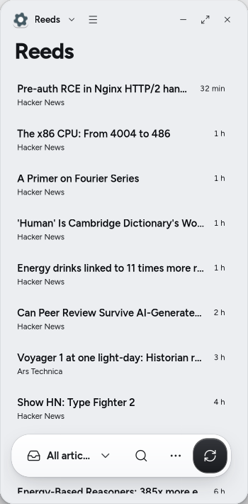
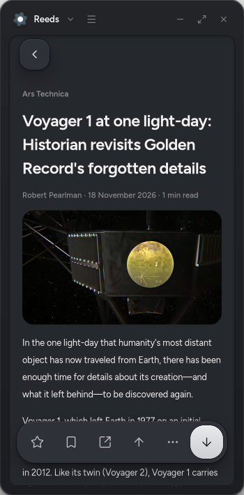

# Reeds

A feed reader for [Luma](https://simplyluma.com). Add a website or feed address and Reeds finds the feed,
keeps the articles on your device and shows what is new. It reads RSS, Atom and RDF, imports and exports
OPML, and works the same on a computer, a tablet and a phone. There is no account and nothing leaves your
device except the requests for the feeds you follow.

<p align="center">
  
</p>

| Tablet | Phone, list | Phone, article |
| --- | --- | --- |
|  |  |  |

The screenshots use sample feeds and articles written for the purpose.

## What it does

- **Add by address.** Type a site like `example.com`; Reeds looks for its feed. `feed://` links work too.
- **Start quickly.** The first launch offers a few suggested feeds, or import an OPML file from another reader.
- **Read.** Articles keep their text, links, quotes, lists, code and pictures. Next and previous move through the list.
- **Keep.** Star an article, or save it to read later. Unsubscribing can be undone.
- **Find.** Search every downloaded article, filter to unread, and group feeds in folders.
- **Light and dark.** Reeds follows the desktop's colour scheme.
- **Motion that shows what happened.** Unsubscribing carries the feed to a bin and tips it in. Starring pops a star,
  Read later carries a bookmark to the Read later place, and opening the original sends an arrow out. Articles slide
  or fade into each other, new articles and feeds fade in, and marking everything read clears the dots in a wave.
  The curves and durations are LumaUI's own. With **Reduce Motion** on, nothing travels and each change is a short
  fade; with animations off, everything simply appears.

Built with LumaUI: `AppWindow`, `NavigationSidebar` and `SidebarFoot`, `ListFirst`, `ActionCenter`,
`CornerPill`, `Toast`, `DestructiveDialog` and `EmptyState`. The only things the app draws itself are an
article's text and pictures (`src/reeds.css`, using Luma colour tokens only).

## Keyboard

Everything can be done without a pointer.

| Keys | What it does |
| --- | --- |
| F6, Shift+F6 | Move between the sidebar, the article list and the article |
| Arrow keys, Enter | Move in a list, open the article |
| Page Up, Page Down | Scroll the article |
| Alt+Down, Alt+Up | Next and previous article |
| Alt+Left | Back to the article list |
| Ctrl+1, Ctrl+2, Ctrl+3 | All articles, Read later, Starred |
| Ctrl+D, Ctrl+B, Ctrl+U | Star, read later, mark as unread |
| Ctrl+Shift+O | Open in the browser |
| Ctrl+C | Copy the selected text |
| Ctrl+N | Add a feed (Escape cancels and returns to where you were) |
| Ctrl+R | Refresh feeds |
| Ctrl+F | Search articles |
| Ctrl+Shift+A | Mark all as read |
| Ctrl+I, Ctrl+E | Import and export feeds |
| F9 | Show or hide the sidebar |

## Privacy

Reeds asks for network access only, to fetch the feeds you add and the pictures in their articles. Links
open through the desktop's portal, and import and export use its file chooser. Your library is a single
SQLite file in the app's data folder. There is no account, analytics or tracking.

## Build and check

Reeds needs the Luma SDK (`org.projectluma.Platform` and `org.projectluma.Sdk`, runtime 44):

```sh
flatpak remote-add --user --if-not-exists luma https://dl.simplyluma.com/luma.flatpakrepo
flatpak install --user luma org.projectluma.Platform//44 org.projectluma.Sdk//44
```

Run it from a checkout, using the SDK's Python, which carries `luma_appkit`:

```sh
flatpak run --command=python3 --filesystem=home --socket=wayland --socket=fallback-x11 \
  --share=ipc --share=network --device=dri org.projectluma.Sdk//44 src/main.py
```

Check and package it:

```sh
flatpak run --command=luma --filesystem=home org.projectluma.Sdk//44 lint
flatpak run --command=luma --filesystem=home org.projectluma.Sdk//44 test
appstreamcli validate --no-net data/io.github.cappedcat1710.Reeds.metainfo.xml
desktop-file-validate data/io.github.cappedcat1710.Reeds.desktop
flatpak-builder --user --force-clean --install --install-deps-from=luma \
  build-dir flatpak/io.github.cappedcat1710.Reeds.json
```

`luma release-check` is expected to fail for now: it needs evidence for `aarch64`, which Luma doesn't build
yet. The evidence file is left unfilled on purpose.

## Layout

| Path | What is in it |
| --- | --- |
| `src/main.py` | The window, the panes, the bars and the keyboard handling |
| `src/reeds_feeds.py` | Fetching, reading RSS, Atom and RDF, OPML, and turning article HTML into blocks |
| `src/reeds_store.py` | The SQLite library |
| `src/reeds_motion.py` | The motion: one overlay layer, LumaUI's easing and durations, Reduce Motion |
| `src/reeds.css` | The article's own text and pictures, and the motion's colours |
| `docs/simplyluma.com-DESIGN.md` | Notes on Luma's design language, used to match the theme |

## License

Apache-2.0. See [LICENSE](LICENSE).
